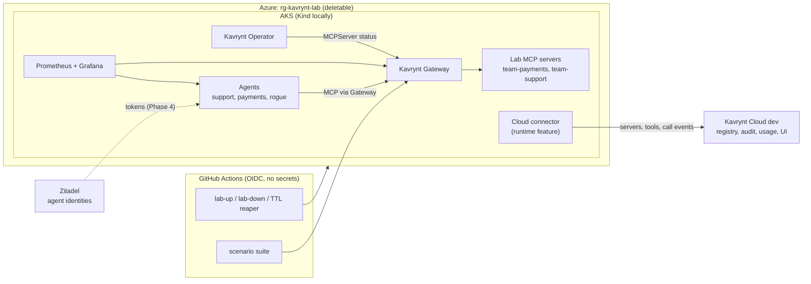

# Kavrynt Labs - plan

A disposable lab where the Kavrynt MCP control plane runs against real MCP servers and
agents, so governance can be watched as it happens - and every runtime and Cloud feature
is proven end to end before customers see it. The lab can be deleted at any time; nothing
in it is a customer or production system.

## Decisions (2026-10-11)

| Question | Decision |
|---|---|
| Azure subscription | **Same subscription as Kavrynt Cloud dev**, with its own resource group, GitHub identity and budget |
| Cloud side | **Connect the lab to the existing Kavrynt Cloud dev** on Azure (`kavrynt-platform`), so the real cluster-to-Cloud path is exercised |
| Cluster-to-Cloud connector | **Built in the `kavrynt` runtime as a real feature**, not a lab shim - customers need it too |
| First step | Phase 1: the same lab on a local Kind cluster |

## Decisions (2026-10-18)

| Question | Decision |
|---|---|
| Repository | Moved to `AI-Platform-Engineering-Labs/azure-ai-labs` (same repository ID); kavrynt-platform's lab identity trusts the new owner |
| Who owns what in Azure | **Split**: kavrynt-platform keeps the bootstrap (resource group, budget, state, identity and the roles it may grant); this repository owns everything inside the resource group |
| How the Azure lab is built | Three workflows in dependency order, each refusing to run before the previous stack exists: **Lab Landing Zone** (network, egress IP) → **Azure Lab** (AKS with Cilium) → **Lab Integrations** (Key Vault, workload identity, Cloud dev reachability) |
| Gateway bypass | NetworkPolicy in the lab (Cilium on AKS, kindnet on Kind) until the runtime ships one (FINDINGS F10) |
| Reaching Kavrynt Cloud dev | A static egress IP kept in the lab landing zone, allowed in Cloud dev's `DEV_ALLOWED_INGRESS_CIDRS` (about USD 4 a month) |
| Secrets (cluster token, agent credentials) | Lab Key Vault, read by pods through workload identity and the Key Vault CSI driver; nothing in Git or Kubernetes Secrets |

## What the lab looks like

## Where governance stands today

| Capability | Status | Lives in |
|---|---|---|
| Register MCP servers, readiness, routing | Works (`0.0.2-beta.1`) | `kavrynt` |
| Inventory of servers and tools, audit events, usage, Control UI | API + UI exist; filled only through `POST /v1/sync/mcpservers`, `/v1/audit-events`, `/v1/usage-events` | `kavrynt-cloud` |
| Cluster to Cloud sync | Missing: nothing in the runtime calls the sync API | to build in `kavrynt` (Phase 3) |
| Gateway authentication, policy (OPA), per-call audit | Design only (ADR-0003) | to build in `kavrynt` (Phase 4) |
| Approvals | Target service | to build in `kavrynt-cloud` (Phase 4) |

The lab encodes the governance we *want* in [`policies/expectations.yaml`](../policies/expectations.yaml)
and measures the gap: every call that policy would deny but the runtime allowed is
counted and shown. As enforcement lands, that gap goes to zero.

## Phases

| Phase | Delivers | Done when | Status |
|---|---|---|---|
| **1. Local lab** | Kind cluster, Kavrynt runtime (release or local source), lab MCP servers with tools at every risk level, scripted agents incl. a rogue one, Prometheus + Grafana governance dashboard, `make lab-up / lab-check / lab-down`, CI that runs the lab on Kind | `make lab-up` then `make lab-check` pass; Grafana shows routing, calls per agent and tool, and the ungoverned-risk gap | **done** (release and source runtime, 2026-10-11; hardened and re-verified 2026-10-12) |
| **2. Azure** | Bootstrap in `kavrynt-platform` (`landing-zone/lab.tf`: lab resource group, `id-kavrynt-github-lab` and the roles it may grant, state container, budget); three lab stacks with Azure Verified Modules and their workflows: `infra/azure/landing-zone` (**Lab Landing Zone**: VNet, NSG, static egress IP, AKS identity), `infra/azure/cluster` (**Azure Lab**: one-node AKS Free tier with Entra ID, Azure RBAC, Cilium and NetworkPolicy, Basic registry; `up` with approval, `down`, TTL reaper), `infra/azure/integrations` (**Lab Integrations**: Key Vault, workload identity, Cloud dev reachability); runbooks | A full create -> check -> destroy from GitHub, cost back to about USD 4 a month when down | **built** (2026-10-12; split into three workflows 2026-10-18); first Azure run after kavrynt-platform's Landing Zone is applied ([azure-setup.md](runbooks/azure-setup.md)) |
| **3. Visibility** | Connector in the runtime: sync MCPServers and their tools (`tools/list`) and per-call usage/audit events to Kavrynt Cloud with a cluster token; lab registered as a cluster in Cloud dev | Calls made in the lab appear in the Cloud UI within seconds | planned |
| **4. Enforcement** | Gateway as OAuth resource server (Zitadel tokens per agent), embedded OPA policies, approvals; scenario suite as acceptance tests | Scenario suite passes: allow, deny and approval outcomes match `expectations.yaml`, every call audited | planned |

## Components

| Component | Where | Notes |
|---|---|---|
| Kind cluster | `kind/cluster.yaml` | Grafana, Prometheus and the Gateway exposed on `127.0.0.1` |
| Azure lab | `infra/azure/{landing-zone,cluster,integrations}`, `.github/workflows/lab-{landing-zone,azure,integrations}.yml` | Network, AKS + registry, Key Vault in `rg-kavrynt-lab`; nothing exposed, reached through `kubectl port-forward`; same manifests and checks as Kind (`TARGET=aks`), plus the integration checks |
| Network isolation | `cluster/workloads/network-policies.yaml` | Only the Kavrynt runtime and Prometheus reach the team namespaces; the rogue agent's direct calls must be blocked (`kavrynt-lab check`) |
| Secret store | `infra/azure/integrations`, `cluster/integrations/` | Lab Key Vault; pods read it as `lab-agents/lab-workload` through workload identity and the CSI driver |
| Kavrynt runtime | `RUNTIME=release` (public Docker Hub chart + images, pinned by digest in `scripts/lab.sh`; default) or `RUNTIME=source` (builds `../kavrynt`, Kind only) | `source` is the real-time loop for runtime development: change Go code, `make runtime-reload` |
| Lab MCP servers | `lab/` (Python, MCP SDK 2.x, protocol `2026-07-28`) | `payments-mcp` and `support-mcp`, tools from read-only to destructive, with MCP tool annotations and Kavrynt risk metadata |
| Agents | `lab/` | `support-agent`, `payments-agent`, `rogue-agent`; each call carries `X-Lab-Agent` and is scored against the expectations |
| Expected governance | `policies/expectations.yaml` | The policy we intend Kavrynt to enforce; source for the dashboard gap today and the scenario suite later |
| Monitoring | `cluster/monitoring/` | Prometheus (pod discovery: Kavrynt Gateway and Operator, plus `prometheus.io/*` annotated lab pods) and Grafana with the governance dashboard |
| Checks | `lab/` (`kavrynt-lab check`, run as a Job) | Routes registered, tools reachable through Gateway, metrics flowing |

## Cost and deletion

- Local lab: free. `make lab-down` deletes the Kind cluster and everything in it.
- Azure lab: about USD 0.20 an hour while the cluster is up (one `Standard_D2ds_v6` node, disk,
  outbound load balancer, Basic registry; AKS Free tier); about USD 4 a month when down - the
  lab landing zone (its static egress IP is the only cost), the Key Vault, and kavrynt-platform's
  resource group, budget, state container and identity remain. The TTL reaper destroys a cluster
  at most two hours after its TTL; the budget on `rg-kavrynt-lab` alerts the subscription
  Owners. Lab Integrations and Lab Landing Zone `destroy` remove the rest.

## Findings

Things the lab exposes about the runtime and Cloud are recorded in [FINDINGS.md](FINDINGS.md)
and fed back to the owning repository as issues.
